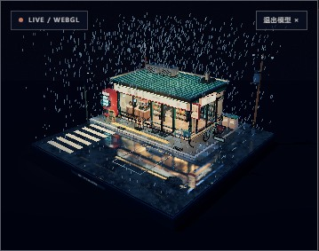

# 从三张名片到一期创刊号

## 藤氏蓝个人站 Issue 01 的制作记录与方法

> 设计不是把页面变好看，而是先回答：这个人应该被怎样看见。

这是一次具体的改版记录，不是通用教程。它包含设计判断、被否掉的方向、实际使用的数字、修过的 bug，以及下次还会复用的做法。

---

## 1. 先把问题定义对

原始需求只有一句：重做个人网站，视觉优先。

“视觉优先”是风格要求，不是设计命题。继续追问之后，约束才清楚：

- 这是个人 IP 的第一步，不是课程销售页；
- 首要任务是立住「藤氏蓝」这个人；
- 身份暂时不定死，教育、作品、技术、写作都要保留；
- 手记以后会变成作者亲自写的长文；
- 没有现成的目标访客画像；
- 不虚构客户、评价、成绩、数据或人像；
- 技术形态要简单，能长期自己维护。

于是给这次改版写了一份自己的设计任务书：

1. **三秒**：知道这是谁，记住一种气质。
2. **十秒**：知道他在做哪几件事，以及从哪里开始看。
3. **三十秒**：能看到真实的证据——课程、作品、项目、文字。
4. **不逼人做选择**：四条线并列，不把多重身份压成一句“AI 教育博主”。
5. **只留一个主要行动**：预约讲解。它出现在页头和版权页，但不打断阅读。
6. **手机上也要像一本刊物**，不是把桌面版缩小。

被否掉的方向：

| 方向 | 为什么不做 |
| --- | --- |
| 通用作品集网格 | 只能展示“做过什么”，不能解释“为什么这样做” |
| 课程落地页 | 会把“人”删减成一张课程海报，和第一步的目标相反 |
| 红金新中式 | 符号太满，容易变成国潮模板，反而失去个人气质 |
| 深色科技风 | 与名片上的纸、墨、印完全冲突，也会让长篇文字难读 |
| 纯手写字体 | 作者明确说手记不一定是手写；而且长文可读性会下降 |

最后定下的命题是：**做一期由本人编辑的刊物**。杂志天然容纳多种栏目，也天然允许“下一期”。

---

## 2. 名片是视觉语法，不是版式模板

三张名片提供的不是布局，而是一套可以拆开重组的语法：

- 暖白纸张，而不是纯白；
- 近黑的墨，不是彩色主视觉；
- 印章红只做重音；
- 中文宋体可以放到极大，当作图形；
- 编号、细线、留白、条形码、版权页，比装饰纹样更有效；
- 印刷物的“边缘”本身可以成为细节：纸层、压痕、页脚、期号。

保留什么、拒绝什么：

| 保留 | 拒绝 |
| --- | --- |
| 纸的底色与纤维感 | 假做旧、撕边、污渍滤镜 |
| 印章红的点状重音 | 大面积红色背景、红金渐变 |
| 宋体大字的骨架 | 书法字体通篇使用 |
| 编号、目录、细线、页脚 | 龙纹、祥云、回纹等符号堆叠 |
| 少量“印”的仪式感 | 每个区块都盖章 |

### 色板

| Token | 色值 | 用法 |
| --- | --- | --- |
| `--paper` | `#f3efe6` | 纸张底色，占全站约八成面积 |
| `--paper-2` | `#e9e3d7` | 次级纸面、内容分区 |
| `--paper-3` | `#d8d0c1` | 纸边、压层、分隔 |
| `--bone` | `#faf7ef` | 深色版面里的“纸” |
| `--ink` | `#151310` | 标题与主文字 |
| `--ink-2` | `#2b2723` | 长文正文 |
| `--ink-3` | `#655f56` | 注释、页脚、次级信息 |
| `--seal` | `#a4432f` | 印章红，唯一强调色 |
| `--seal-deep` | `#7f3021` | 红色的暗部 |
| `--seal-bright` | `#c4785f` | 深色版面里的红色 |

约束是刻意的：**红色只做“印”**。一屏里通常只出现一两个红色元素。红色一多，纸和墨就失去主次，刊物会变成海报。

### 字体与排版

- **中文标题**：Noto Serif SC，可变字重 200–900。封面主标题用 900，栏目标题用 600–700。
- **中文正文**：系统无衬线优先。长文阅读比“全站宋体”更重要，且系统字体在 Windows / macOS / 手机上都有稳定表现。
- **拉丁点缀**：Instrument Serif，斜体用于卷首语、英文刊名与数字。
- **元信息**：IBM Plex Mono，用于期号、栏目、页码、标签；只对拉丁字母和数字使用大写与字距。

具体尺度（节选）：

```css
/* 封面刊名 */
font-size: clamp(4rem, 15vw, 15rem);
line-height: .8;
letter-spacing: -.05em;

/* 封面故事标题 */
font-size: clamp(2.7rem, 5.9vw, 6.2rem);
line-height: 1.04;
letter-spacing: -.04em;

/* 正文 */
font-size: clamp(.98rem, 1.22vw, 1.12rem);
line-height: 1.85;
```

中文排版里最容易忽略的三件事：

1. **大字要收紧字距**，否则宋体的横画会显得松散；负字距只在展示级标题上使用。
2. **正文不能被“设计感”牺牲**：行高 1.85，长文段落 2.0，比装饰性更重要。
3. **断行要写死**：中文标题靠自动平衡经常出现孤字或语义断裂。最终用显式 `<br>` 控制关键标题的断句，而不是依赖 `text-wrap: balance`。

### 印刷物的细节清单

封面用了这些“非装饰”的细节：

- 期号 `01` 与 `VOL. 01`；
- 报头两侧的期刊信息；
- 封面故事标签 `COVER STORY / 封面故事`；
- 目录的页码与栏目编号；
- 页脚 folio；
- 条形码与 `ISSUE 01 / FREE / 免费阅读`；
- 版权页（colophon）与“本期制作”；
- 竖排书脊文字。

它们的功能不是复古，而是告诉读者：**这是一份被编辑过的东西**。

---

## 3. 为什么是“创刊号”

个人站最常见的结构是：Hero → 关于 → 服务 → 作品 → 联系。它没有错，但会把多种身份排成一条销售漏斗。

创刊号的结构解决的是另一个问题：**如何让四种身份同时成立，又不互相打架。**

| 区块 | 在刊物里的角色 | 承担的内容 |
| --- | --- | --- |
| 封面 | 报头、期号、封面故事、封面导读 | 一句话方法、四条内容线、主行动 |
| 目录 | 深色跨页，阅读节奏的转折 | 四条线 + 联络方式 + 页码 |
| 封面故事 | 人物报道 | 为什么做这些事、怎么做、相信什么 |
| 教育 | 部门 | 两门课、教学理念、适合谁 |
| 作品 | 部门 | 真实视频与播放数据、内容方向 |
| 立体附录 | 别册 | 可交互的 3D 微缩场景 |
| 技术 | 部门 | Varve、自动化工作流、研究方向 |
| 手记 | 专栏 | 观点短文与审美来源；以后替换成长文 |
| 版权页 | 刊物收尾 | 联络、预约、制作说明 |

### 封面文案

主标题不是口号，而是方法：

> **把东西做出来，把过程写下来。**

它同时解释了教育（做东西）、技术（做出来）与写作（写下来），也给整站定了一个动词开头的语气。

副文案明确边界：

> 一个在重庆做 AI 教育的人，关于技术、教学与写作的第一次合刊。我不卖焦虑，也不假装什么都会：把复杂讲简单，把想法做成东西，然后老实记下中间发生了什么。

这段话做了三件事：交代地点与身份、拒绝“全能专家”的人设、把“过程”立为核心价值。

### 行动按钮的分寸

全站只有一个主要行动：**预约半小时免费讲解**。

- 它出现在页头，任何一页都能到达；
- 它在版权页再次出现，给读完的人一个出口；
- 没有弹窗、没有浮窗客服、没有自动播放的视频；
- 内容永远排在行动之前。

对一个还没有明确访客画像的个人站来说，过早优化转化率会破坏“先认识人”的目标。

---

## 4. 立体感：两层，不是满屏特效

“立体”在站里分两层，成本与目的完全不同。

### 第一层：纸的物理逻辑（CSS）

- 头像、Varve 卡片、立牌使用 2–3 层纸背板，轻微旋转与错位；
- hover 时整块抬起，阴影加深，但不是夸张的 3D 翻转；
- 封面滚动时，巨大的期号与头像以不同速度轻微漂移；
- 所有漂移在 `prefers-reduced-motion` 和窄屏下关闭。

原则是：**立体感来自层与层的关系，不来自动画数量。** 纸张最多三层；再多就会像网页特效，而不是印刷物。

### 第二层：真的 3D（WebGL）

本地做好的雨夜便利店微缩模型，被处理成杂志的“立体附录”：

- 默认只显示海报；
- 点击「启动 3D 场景」后才加载 iframe；
- 加载时显示 `Loading / WebGL`，完成后变为 `Live / WebGL`；
- 提供「退出模型」按钮，移除 iframe 的 `src`，释放 WebGL 上下文；
- 场景支持拖动旋转、滚轮缩放、右键平移；
- iframe 有独立标题，状态通过 `aria-live` 播报；
- 场景文件自包含，不请求外部模型或图片。

实测数据：

| 项目 | 数值 |
| --- | --- |
| 3D 场景文件 | 778,728 字节（约 760 KB） |
| 场景规模 | 约 247k 三角形 / 2,101 个图元 |
| 静态海报 | 286,561 字节 |
| 首次加载 | 只有海报；3D 在点击后请求 |

为什么不把它放在首屏：

- 一个 760 KB 的 WebGL 场景会抢走“读人”的注意力；
- 自动加载会让首屏变慢，也会在低端设备上掉帧；
- 作为附录，它是“翻到别册才发现”的惊喜，而不是门面。



> 场景：`web/assets/plate/after-the-last-train.html`；海报：`web/assets/plate/after-the-last-train.jpg`。

### 立体的边界

- 不用 3D 替代信息：所有关键内容在静态 HTML 里可读；
- 不让动画控制滚动：没有滚动劫持；
- 不让装饰挡住操作：所有覆盖层都有退出路径；
- 不在移动端强行开启漂移：窄屏优先稳定与性能。

---

## 5. 工程：把“没有构建”当成约束

### 文件结构

```text
web/
├── index.html          创刊号首页
├── teach.html          教育与服务
├── works.html          内容与作品
├── tech.html           技术与研究
├── notes.html          手记
├── contact.html        联系
├── css/
│   ├── site.css        设计系统与内页
│   └── issue.css       首页专用
├── js/
│   └── site.js         渐进增强
└── assets/
    ├── avatar.jpg
    ├── fonts/          自托管字体子集
    ├── plate/          3D 场景与海报
    └── *.pdf           课程体验版
```

没有 npm、没有打包器、没有运行时依赖。改一个 HTML 文件就能改一个页面；这对一个需要长期自己维护的个人站，比“工程化”更重要。

### 渐进增强

- 内容在 HTML 里，JS 失效也能读；
- 移动菜单、筛选、复制、阅读进度、3D 启动都是增强；
- 所有按钮都有真实语义，`aria-expanded` 同步状态；
- 3D 的 iframe 默认没有 `src`，不点击就不加载；
- 滚动揭示只在支持 `IntersectionObserver` 时生效。

### 字体工程

这是整次改版里最容易被低估、也最容易毁掉视觉的一环。

站内中文使用 Noto Serif SC 的子集：

1. 从所有 HTML / CSS / JS 里汇总实际用字，写入 `font-build/chars.txt`；
2. 用 `pyftsubset` 生成 woff2，保留可变字重；
3. 结果约 579,012 字节，覆盖 1,076 个码位（含站内出现的一处日文假名）；
4. `@font-face` 声明 `font-weight: 200 900`，让一个文件服务多个字重；
5. 字体栈里显式加入 `Noto Serif SC` 作为等宽字体的中文回退，避免落到 NSimSun 这类点阵宋体；
6. 发布前做字体审计：用 canvas 测量每个字符在目标字体与后备字体下的宽度，宽度不同即视为回退。

重建脚本在 `font-build/build-subset.sh`。如果文案新增了子集外的字，必须重新生成，否则页面会出现“同一段文字里有几个字长得不一样”的问题。

### 性能预算

- 首屏只加载 HTML、CSS、字体与头像；
- 3D 场景按需加载；
- 海报和图片有明确宽高，避免布局抖动；
- 没有第三方脚本、字体 CDN、统计脚本或外部请求（3D 场景也是自包含的）；
- 动画只改 `transform` / `opacity`，避免触发布局。

### 可访问性

- 跳到正文的 skip link；
- 可见的 `:focus-visible` 状态；
- 图片有替代文本，装饰图形 `aria-hidden`；
- 3D iframe 有标题，加载与退出通过 live region 播报；
- 退出 3D 后焦点回到启动按钮；
- `prefers-reduced-motion` 下关闭漂移与揭示动画；
- 移动菜单展开时锁定背景滚动，并修正深色菜单里的页头对比度。

---

## 6. QA：验收的是行为，不是截图

发布前做过的检查：

| 检查 | 方法 | 结果 |
| --- | --- | --- |
| HTML 结构 | 重复 ID、未闭合标签、local `href/src` 是否存在 | 通过 |
| JS 语法 | `node --check web/js/site.js` | 通过 |
| 字体回退 | canvas 逐字符宽度比对，覆盖六个页面 | 0 处回退 |
| 响应式 | 320 / 390 / 430 / 768 / 1024 / 1280 / 1440 px | 无横向溢出 |
| 3D 启动 / 退出 | 1440 与 390 宽度实际点击，确认 WebGL 渲染与退出 | 通过 |
| 移动菜单 | 展开后的文字对比度、滚动锁定 | 修复后通过 |
| reduced motion | 模拟系统偏好，确认漂移与揭示关闭 | 通过 |
| 视觉截图 | 按区块截图 + 整页截图交叉检查 | 通过 |

### 实际修过的 bug

1. **中文小字回退到 NSimSun**：等宽字体栈里没有中文字体，`©`、页码等字符落到了点阵宋体。把 `Noto Serif SC` 放进 mono 栈并重建子集后解决。
2. **巨大期号不可见**：`01` 的淡色层与纸面几乎同色，调整透明度与混合方式后恢复。
3. **版权页孤字**：桌面端出现单字成行。尝试 `text-wrap: balance` 无效后，改为显式断行，让三种宽度下都读得通。
4. **手机菜单页头对比度不足**：深色菜单展开时，页头的期号仍是墨色。增加 `body[data-menu="open"]` 下的颜色覆盖。
5. **懒加载海报截图全黑**：元素截图没有触发滚动，图片尚未进入视口。改用整页截图确认，避免误判。

### 没有验证的部分

- 没有做真机 Safari / Firefox 回归，主要在 Chromium（Edge）里验收；
- 没有跑自动化无障碍扫描，可访问性来自手工检查；
- 3D 场景在低端集显与移动端上的帧率没有做完整矩阵测试。

这些限制应该写出来，而不是用“已完成”掩盖。

---

## 7. 发布：让源文件只有一个真相

- 源文件以 `web/` 为准；
- 发布前的 `dist/` 只是复制出来的静态副本，不提交；
- Qoder Sites 的本地描述文件包含项目与发布标识，不进入公开仓库；
- 发布流程：本地预览 → 构建/复制 → 准备草稿 → 核对线上 → 发布 → 验证 `published` 状态；
- 站点没有后端、数据库、密钥或表单上传，联系表单只生成预写邮件。

更新时最重要的不是“发布成功”，而是确认**线上版本确实包含这次改动**。如果只看到构建成功或草稿就绪，不能当作已经上线。

公开仓库与线上站点保持同源：

```text
修改 web/ → 如改文案则重建字体 → 本地验收 → 更新发布副本 → 发布 → 核对线上
```

---

## 8. 可复用的清单

下次做个人站或品牌站，可以直接照这张表走：

- [ ] 先用一句话说清“这个站首先要让谁被看见”，再谈风格。
- [ ] 从参考物里提取**语法**（颜色关系、字体关系、细节类型），不要复制版式。
- [ ] 限定一个强调色，并写清它只能出现在哪里。
- [ ] 先做一张真正的首页，而不是先搭组件库。
- [ ] 检查最大的标题在 320 px 宽度下是否还成立。
- [ ] 正文行高与字号优先于“设计感”。
- [ ] 关键标题的断行手动确认，避免孤字。
- [ ] 字体子集从实际文案生成；发布前做回退审计。
- [ ] 重资产（3D、视频、大图）默认不加载，给明确入口与退出路径。
- [ ] 所有动效都能在 `prefers-reduced-motion` 下关闭。
- [ ] 用真实设备宽度检查，不以元素截图代替整页截图。
- [ ] 发布后核对线上，而不是只看构建状态。

---

## 9. 分工与边界

这次改版里，人的部分和工具的部分应该分开说：

- **作者提供**：身份、经历、课程、项目、真实数据、可用素材，以及最终的方向选择与发布授权。
- **制作完成**：设计命题、视觉系统、页面结构、排版、交互、3D 接入、字体工程、QA 与发布执行。
- **共同守住**：不虚构、不冒充、不用生成内容填补真实经历的空白。

AI 可以协助把素材组织成版面，但不能替作者 invent 一个更成功、更完整的人。这个站的可信度来自“真实材料 + 编辑判断”，而不是来自生成能力。

---

## 10. 如果再做一次

1. **更早定义访客**。这次先立人、后定受众是合理的，但下一期应该明确“谁来读”，再决定栏目比例。
2. **补真机测试**。Safari 的中文字体渲染、移动端 WebGL 性能，都值得单独回归。
3. **手记先写成长文**。现在的短卡片是占位结构；等长文到位，应该给手记独立的阅读页，而不是继续加卡片。
4. **封面在短视口上再收一点**。1440×900 下封面高约 1,029 px，主按钮落在首屏之外；页头 CTA 仍在，但如果要更稳妥，可以为矮屏增加一档高度压缩。
5. **把 3D 做成系列**。如果以后还有新的微缩场景，可以固定为“别册”栏目，每期一个，而不是把首屏堆满。

---

## 关键文件

- 首页结构：[`web/index.html`](web/index.html)
- 首页视觉：[`web/css/issue.css`](web/css/issue.css)
- 全局设计系统：[`web/css/site.css`](web/css/site.css)
- 交互与 3D 启动：[`web/js/site.js`](web/js/site.js)
- 3D 场景：[`web/assets/plate/after-the-last-train.html`](web/assets/plate/after-the-last-train.html)
- 字体子集脚本：[`font-build/build-subset.sh`](font-build/build-subset.sh)
- 首页截图：[`docs/images/cover-desktop.jpg`](docs/images/cover-desktop.jpg) / [`docs/images/cover-mobile.jpg`](docs/images/cover-mobile.jpg)
