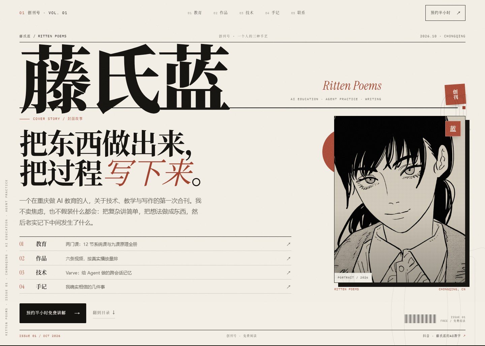

# 藤氏蓝 · Ritten Poems

> 把东西做出来，把过程写下来。

这是 [藤氏蓝 · 创刊号](https://ritten-poems-ypc90av6yj3.qoder.zone/) 的完整源码。一个没有构建步骤的中文个人网站：暖纸、墨黑、印章红，宋体大字、细线、期号与版权页。

视觉语言来自三张名片，结构借自杂志——封面故事、目录、部门、立体别册、版权页。它首先想立住一个人，而不是先卖一门课。

[](https://ritten-poems-ypc90av6yj3.qoder.zone/)

## 这一版做了什么

- **把首页做成「创刊号」**：报头、期号、封面故事、目录、四条内容线、立体附录、版权页，用编辑结构承接多重身份。
- **不把身份压成一句标签**：教育、作品、技术、手记并列，先让人看见「在做什么」，再决定从哪条线认识他。
- **只用真实材料**：课程大纲来自实际课程文档，项目数据来自仓库与运行结果，播放数据来自账号后台；没有虚构客户、学员评价或成绩。
- **把 3D 微缩做成「立体附录」**：默认显示海报，点击后才加载 WebGL 场景；可拖动旋转、滚轮缩放、右键平移，也可随时退出。
- **纯静态**：HTML + 两份 CSS + 一份渐进增强脚本；没有框架、构建、后台，站点代码里也没有统计脚本。
- **中文排版按实际用字做字体子集**：约 566 KB 的自托管宋体，覆盖站内全部中文、标点与少量日文假名。

## 本地预览

```sh
py dev-server.py        # Windows
# 或
python dev-server.py
```

打开 <http://127.0.0.1:8123/>。

建议用本地服务器查看：3D 附录以 HTTP 路径加载。直接双击 `web/index.html` 也能读大部分页面，但 3D 场景可能受浏览器 `file://` 限制。

## 目录

| 路径 | 作用 |
| --- | --- |
| `web/index.html` | 创刊号首页：封面、目录、封面故事、教育、作品、立体附录、技术、手记、版权页 |
| `web/teach.html` | 教育与服务：教育理念、教学线、Agent 课程大纲、合作流程、常见问题 |
| `web/works.html` | 内容与作品：账号数据、视频片单、内容方向、创作方法 |
| `web/tech.html` | 技术与研究：Varve、视频自动化工作流、研究方向 |
| `web/notes.html` | 思考与手记：观点短文、审美来源 |
| `web/contact.html` | 联系：静态报名表（生成预写邮件）、邮箱与微信 |
| `web/css/site.css` | 全局设计系统与内页样式 |
| `web/css/issue.css` | 首页「创刊号」专用样式 |
| `web/js/site.js` | 移动目录、筛选、复制、阅读进度、3D 启动、滚动揭示 |
| `web/assets/` | 头像、课程体验版 PDF、字体子集、3D 模型与海报 |
| `font-build/chars.txt` | 字体子集字符表，由站内文案自动汇总 |
| `font-build/build-subset.sh` | 重新生成宋体子集 |
| `docs/images/` | README 与制作记录使用的截图 |
| `dev-server.py` | 本地静态预览服务器 |

## 设计系统

### 色板

| Token | 色值 | 角色 |
| --- | --- | --- |
| `--paper` | `#f3efe6` | 纸张底色，整站背景 |
| `--paper-2` | `#e9e3d7` | 次级纸面、分区底色 |
| `--paper-3` | `#d8d0c1` | 纸边、分隔与压层 |
| `--bone` | `#faf7ef` | 深色版面上的“纸” |
| `--ink` | `#151310` | 正文与标题的墨色 |
| `--ink-2` | `#2b2723` | 长文正文 |
| `--ink-3` | `#655f56` | 注释、页脚、次级信息 |
| `--seal` | `#a4432f` | 印章红，唯一强调色 |
| `--seal-deep` | `#7f3021` | 红色的暗部 |
| `--seal-bright` | `#c4785f` | 深色版面上的红色 |

红色只用来做“印”：期号、印章、箭头、重点词。它不铺大面积，不和第二种强调色争位置。

### 字体

- **Noto Serif SC**：中文标题、引文与编辑性文字；可变字重 200–900，标题常用 700/900。
- **系统无衬线**：长正文，优先 PingFang SC / HarmonyOS Sans SC / 微软雅黑，保证长文阅读。
- **Instrument Serif**：拉丁字母、卷首语与数字的点缀，只出现在需要“西文印刷感”的位置。
- **IBM Plex Mono**：期号、栏目、标签、页码等元信息，配合大写与字距。

排版约定：

- 展示级中文标题用 `clamp()` 随视口缩放，行高压到 0.78–1.06，字距收紧到 `-0.04em` 左右。
- 正文行高 1.85；编辑性长文 2.0；元信息 1.5–1.7。
- 不靠 `text-wrap: balance` 处理中文标题换行，关键标题用显式 `<br>` 控制断句，避免出现孤字或语义断裂。
- 中文不用全大写、不用夸张字距；等宽字距只服务拉丁字母与数字。

### 版面

- 内容宽度 `min(1440px, 92vw)`，页边距随视口变化。
- 用细线、编号、页边注、期号、条形码、版权页建立“印刷物”的秩序，而不是做旧纹理。
- 素材规则：没有真实来源的图片不生成、不冒充；空缺就明确写“这里还缺什么”。

## 修改内容

- **首页**：改 `web/index.html` 与 `web/css/issue.css`。
- **内页**：改对应的 HTML，共用 `web/css/site.css`。
- **交互**：改 `web/js/site.js`；所有功能在禁用 JS 时仍应能读到内容。
- **加一条视频**：在 `works.html` 的 `.shots` 里复制一个 `<a class="shot">`，填真实链接、主题、标题与播放量。
- **加一门课 / 一条服务线**：在 `teach.html` 复制一个 `.offer__item`，保持真实信息与可展开结构。
- **加一篇文章**：在 `notes.html` 的 `.notes-grid` 复制一张 `.note-card`；文章变长后拆成独立页面并从卡片链过去。

### 改了文案之后：重建字体子集

站内中文使用按实际用字生成的子集。新增了子集里没有的字，浏览器会回退到系统字体，排版会“跳字”。

```sh
cd font-build
sh build-subset.sh /path/to/NotoSerifCJKsc-VF.otf
```

依赖：

```sh
python -m pip install fonttools brotli
```

源字体约 55 MB，不入库；从 <https://github.com/notofonts/noto-cjk> 下载 `NotoSerifCJKsc-VF.otf`。

### 3D 附录

`web/assets/plate/after-the-last-train.html` 是自包含的 Three.js 场景，约 760 KB，不请求外部模型或图片；`after-the-last-train.jpg` 是它的静态海报。

首页默认只加载海报；点击「启动 3D 场景」后才把 iframe 的 `src` 指向场景文件。退出时移除 `src`，释放 WebGL 上下文。修改场景请直接替换这两个文件，并保留海报作为降级画面。

## 内容与数据原则

- **不虚构**：企业客户、机构案例、学员评价、课时价格、播放数据、个人人像，没有真实材料就不写。
- **数据带日期**：抖音播放、获赞、粉丝等数字为 2026-10-15 的快照；更新数字时同步更新页脚日期与说明。
- **课程以文档为准**：课程大纲、阶段目标与适合人群来自实际课程文档；先改文档，再改页面。
- **项目以仓库为准**：Varve 的运行数据、兼容性与已知限制以 <https://github.com/rittenpoems-beep/varve> 为准，页面只做转述。

## 部署

这是纯静态站点，所有链接都是真实文件路径：

1. 把 `web/` 作为站点根目录发布；
2. 不需要 Function、数据库或 SPA 回退；
3. 发布前在本地跑一遍 `dev-server.py`，检查首页、内页、字体与 3D 附录。

`dist/` 只是本地的发布副本，已被 `.gitignore` 排除；源文件以 `web/` 为准。

## 制作方法论

从需求判断、视觉系统、结构设计、3D 接入、字体工程到 QA 与发布，完整记录在 **[METHODOLOGY.md](METHODOLOGY.md)**。

## 许可与第三方

- 代码：[MIT](LICENSE)
- 文字、课程资料、图片、头像、3D 场景与版式：[内容版权说明](LICENSE-CONTENT.md)
- 字体：SIL OFL 1.1，见 [`web/assets/fonts/README.md`](web/assets/fonts/README.md) 与 [`OFL.txt`](web/assets/fonts/OFL.txt)
- 3D 场景内包含 Three.js，MIT 许可，其许可文本保留在场景文件头部
